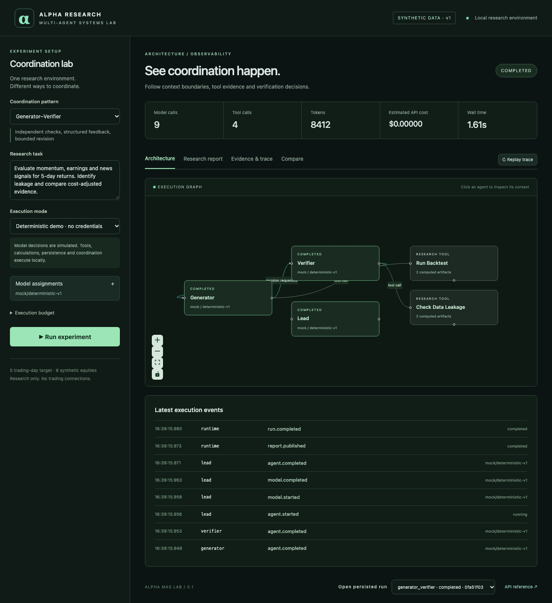

# Alpha Research MAS Lab

An observable, Python-first laboratory for comparing agent coordination over a common equity
research task. Model decisions are simulated in Demo Mode; coordination, typed tools, backtests,
SQLite persistence and event streaming execute locally.

**Current delivery:** Single-Agent baseline, Generator–Verifier and Orchestrator–Subagent work
end to end. Six live-provider adapters are implemented and tested with mocked HTTP.
**No paid provider has been smoke-tested.** Agent Teams, Message Bus, Shared State and Hybrid
remain disabled in the UI. This is a working initial increment, not the complete brief.
See [milestone status and continuation](docs/status.md).



## Run locally

Prerequisites: Python 3.12+, [uv](https://docs.astral.sh/uv/getting-started/installation/),
Node 22.12+ or 24, npm. Docker, Redis and API credentials are unnecessary for this increment.

```sh
uv sync --locked
npm ci --prefix frontend
npm run build --prefix frontend
uv run uvicorn alpha_mas.api.app:app --host 127.0.0.1 --port 8000
```

Open **http://127.0.0.1:8000**. API documentation: **http://127.0.0.1:8000/docs**.
Run Generator–Verifier to observe leakage rejection, feedback, a computed revision and acceptance.
Click an agent, open the research report, then replay the persisted trace without inference.

For frontend development, run the API above and `npm run dev --prefix frontend` in another
terminal; open http://127.0.0.1:5173. Vite proxies `/api` to the backend.
The backend mounts `frontend/dist` at startup, so restart it after the first UI build.

In the implementation environment, uv and Node were installed locally, outside source control.
For this checkout only, expose them before using the commands above:

```sh
export PATH="$PWD/.venv/bin:$PWD/.tools/node-v22.16.0-darwin-x64/bin:$PATH"
```

## What works

- Seeded, checksum-verified synthetic OHLCV, earnings and timestamped news for 8 equities.
- Actual cross-sectional IC, purged train/test split, next-open 5-day portfolios, turnover costs,
  compounded returns, drawdown and explicit exclusion of a deliberately leaking factor.
- Role-level model selection, homogeneous/mixed presets, saved configurations and capability checks.
- GLM, DeepSeek, Qwen and Kimi Chat adapters, native OpenAI Responses and Anthropic Messages.
- Multi-turn tools, multiple calls per response, opaque reasoning-state continuation, usage records,
  retry/fallback attribution, token/call/step/runtime limits and conservative estimated-cost allowances.
- Isolated worker contexts, parallel bounded investigations, deterministic verification and synthesis.
- Persisted causal events, reports, findings, tool artifacts, SSE reconnect/replay and cancellation.
- Partial results survive server restart. Interrupted runs are marked explicitly; paid calls never
  resume automatically. Unique logical artifact keys prevent duplicate commits.

## Live inference (opt-in)

Copy `.env.example` to `.env`. Put keys on the backend only. Set `ALPHA_ALLOW_LIVE=true`
only when ready for bounded paid calls, then select Live Mode and a documented model in the UI.
GLM's profile includes dated reference pricing. Other profiles need explicit current prices in
`config/models.json`; missing prices block live execution rather than treating cost as zero.
Qwen requires a region/workspace URL matching its key. Presets are **candidates**, not verified
performance recommendations. Unverified live status is visible in every model selector.

Recognized keys: `ZAI_API_KEY`, `DEEPSEEK_API_KEY`, `DASHSCOPE_API_KEY`, `MOONSHOT_API_KEY`,
`OPENAI_API_KEY`, `ANTHROPIC_API_KEY`. No credential aliases are recognized.

Optional paid smoke test (never run by CI):

```sh
uv run python scripts/smoke_provider.py --allow-paid --provider glm --model glm-4.7 --max-cost 0.02
```

This runs a bounded baseline with genuine tool calls, writes `alpha-smoke.db`, and exits nonzero
if it cannot complete. A conservative allowance can stop it before the first call or between calls.
Cost figures are estimates, not guaranteed billing caps. See [provider integration](docs/provider-integration.md).

## Check and evaluate

```sh
make check
make test
npm exec --prefix frontend -- playwright install chromium
npm run test:e2e --prefix frontend
uv run python scripts/evaluate.py --repetitions 2 --output /tmp/alpha-evaluation.json
```

CI uses mock HTTP and synthetic fixtures exclusively. The harness records actual process outcomes;
it does not rank real-market profitability or claim simulated tokens predict live-provider efficiency.

## Design and limitations

[Architecture](docs/architecture.md) · [Pattern mapping](docs/pattern-mapping.md) ·
[Research methodology](docs/research-methodology.md) · [Model benchmarking](docs/model-benchmarking.md) ·
[Evaluation](docs/evaluation.md) · [Demo guide](docs/demo-guide.md)

The architecture follows [Anthropic's five coordination patterns](https://claude.com/resources/articles/multi-agent-coordination-patterns).
Async Python is sufficient for the first three mechanisms; LangGraph and Redis are deferred until
they serve a concrete checkpoint/transport requirement. SQLite is the initial local store.
The app binds to loopback by default and has no multi-user authentication or deployment setup.
Provider token streaming, full checkpoint resumption, durable worker leases, collaborative evidence
versioning, Redis delivery/recovery and automated live model comparisons remain future work.

**Synthetic research demonstration only. Not investment advice. No brokerage or order execution.**
