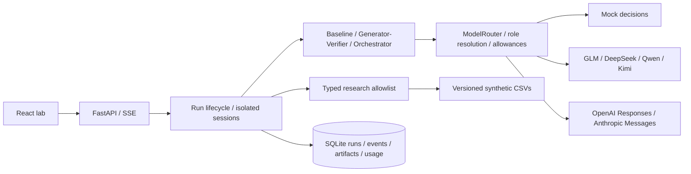

# Architecture — implemented increment

A modular monolith with an asynchronous FastAPI control plane and React/TypeScript interface.
The API starts background run tasks, returns a durable run ID, and streams persisted events via SSE.
The frontend graph derives its nodes and handoffs from these events; replay reads the same log.

`models.py` owns Pydantic v2 contracts. `providers` translates wire formats. `routing` resolves roles,
checks capabilities, reserves allowances, classifies errors and records each attempt. `research`
performs computations. Pattern modules define distinct coordination control flow. `runtime.Session`
owns a private context, scoped instructions and a tool loop. Only allowlisted, validated tools execute.
No model can generate shell commands or arbitrary executable research code.

The session persists large tool outputs as artifacts and supplies compact results plus references
to the model. Tool schemas are narrowed to the current assignment factor, with a separate runtime
scope guard. After a tool loop finishes, prior messages are compacted into a private evidence-backed
memory in the same context identity. Full tool outputs remain in storage. Compaction events are
observable; no pending tool-call conversation is truncated. Model-private reasoning remains in memory solely for provider continuation. Traces
contain observable actions, usage and concise summaries. They never expose opaque reasoning blocks.
Raw provider error bodies are discarded. Known credential values are redacted on persistence.

Lifecycle: queued → running → completed / failed / budget_exceeded / timed_out / cancelled.
Startup marks abandoned queued/running records interrupted. This preserves partial artifacts but
is **not** checkpoint resumption. Tool computations run in threads; cancellation discards later
outputs, although a running local calculation may finish in its thread. TaskGroup cancels sibling
workers on failure; no detached paid inference loop remains.

SQLite uses WAL, transactional writes and parameterized queries. Events have durable sequence
numbers, run/task/agent IDs, causal parents and output references. Artifacts have a unique
`(run_id, logical_key)` constraint. A fresh process writing the same logical result receives the
original committed artifact. Full worker lease/ack recovery remains pending. No exactly-once
execution guarantee is claimed. SQLite connections are short-lived; PostgreSQL migration is future
work and is not claimed to be validated merely because the schema uses simple SQL.

Run requests retain assignments, budgets, dataset and pattern. Every inference attempt records
requested, actual and original models, usage, cost completeness, latency and retry number. Unknown
usage stops subsequent paid calls after a response; retries retain conservative reservations for
failed attempts. A single short lock protects allowance accounting, not research execution.

Implementation decisions: [ADR 001](decisions/001-foundation.md). Scope: [status](status.md).

Tool-loop bounds: each assignment has one required result (research backtest, independent check or
lead decomposition). Duplicate requests use a cache keyed by normalized typed arguments and return
the original artifact reference. Only the first eight requests of a response are eligible; excess
requests receive correlated errors, not execution. Every call ID is answered for valid provider
continuation. After the required result exists, tools close for the summary invocation. Rejections
and reused results are observable; model-call and step budgets bound repeated invalid behavior.
Artifact logical keys include the assignment number so compaction and reused provider call IDs
cannot collide across sequential assignments. No execution limit was raised to handle large batches.
