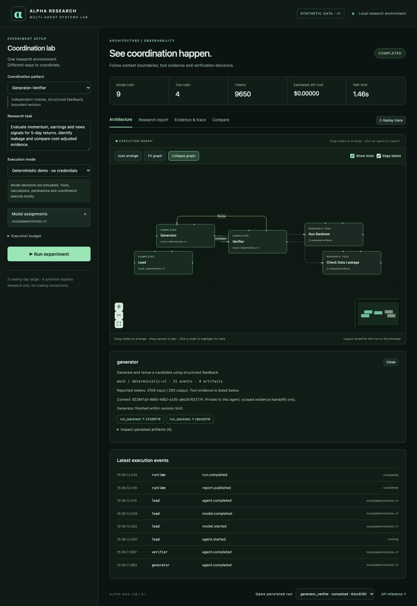

# Leadership demonstration — initial increment (10–15 minutes)

Preparation: follow README startup, keep the backend on loopback, use Demo Mode. No internet,
credentials or manual database edits are needed after dependency installation. This demonstrates
three mechanisms, not all five. Use the UI's pending entries to explain the remaining work honestly.

1. **0–2 min: establish the control.** Select Single Agent, run the fixed task. One context uses
   actual backtest tools across momentum, earnings and sentiment. Open Research report and show
   synthetic labels, held-out IC, complete-sample net returns and limitations.
2. **2–5 min: explicit quality gates.** Select Generator–Verifier and run. Inspect separate generator
   and verifier contexts. In Research report, attempt 1 rejects forward-return leakage; attempt 2
   accepts the corrected temporal implementation. Acceptance means integrity, not profitable alpha.
   Evidence & trace exposes feedback, revision and each tool artifact reference.
3. **5–8 min: independent work.** Run Orchestrator–Subagent. The lead submits a decomposition and
   three temporary workers execute independently. Click Earnings: show scope/context ID, assigned
   model and tools. Returned evidence goes to lead synthesis, without shared conversation histories.
4. **8–10 min: model dimension.** Open model assignments. Show one model for every role, overrides,
   saved configurations and mixed-provider candidates. Explain live-unverified labels, unknown price
   rejection and server-side paid opt-in. Return to the credential-free preset before running again.
5. **10–12 min: inspect and compare.** Open Compare to inspect calls, tokens, time, cost completeness
   and explicit assignments/budget. These are descriptive measurements of different workloads.
   Simulated model tokens and zero API cost cannot establish a live-model cost advantage.
6. **12–15 min: replay/reliability and scope.** Reopen a persisted run and click Replay trace. It
   animates stored events, with no new model calls. Show partial artifacts from a low call-budget
   run. Describe tested deduplication and startup interruption, then the pending leases, Redis,
   collaborative board and hybrid evidence chain.

Backup: retain completed demo runs in the local SQLite database; Run history reopens them. A fresh
checkout can regenerate all three locally. `scripts/evaluate.py` produces a portable JSON backup
of measurements. There is no bundled fictional transcript pretending to be a live execution.

Do not present the initial increment as the complete five-pattern leadership demonstration. The
final hybrid earnings-event story requires Phase 2/3 implementation and separate acceptance tests.

## Arranging the execution graph

Agents and research tools are draggable. Drag empty canvas to pan; use the zoom buttons or the
minimap to navigate. Click an agent to inspect it and highlight its immediate relationships.
Tool nodes can also be selected to highlight their callers. Clear highlight or click the canvas
to restore all connections.

| Control | Behavior |
|---|---|
| Auto arrange | Restore the layered default positions and clear this run's saved manual layout. |
| Fit graph | Center and zoom to the currently visible nodes without changing their positions. |
| Expand graph | Give the canvas more screen height; Collapse graph restores the regular view. |
| Show tools | Hide/show tool nodes and their links to concentrate on agent coordination. |
| Edge labels | Hide/show the short handoff and feedback labels. |

Solid green arrows show forward handoffs; gold feedback arrows use a separate route; dashed arrows
show tool calls. Repeated handoffs are aggregated with a count. This is a view of recorded events,
not an editable execution plan: nodes can move, but links cannot be rewired or deleted.

Manual positions persist per run in local browser storage across tab switches, reloads and replay.
Streaming events still update statuses and evidence counts, but do not reset dragged positions or
a manually adjusted viewport. Layouts are local to the browser, not shared with other users. If
browser storage is unavailable, the layout remains usable for the current view. No model calls
are needed to move, highlight or filter the graph.

